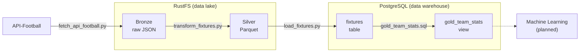

# Real-Time Football Data Pipeline :soccer::oil_drum::hammer_and_wrench:
[](https://github.com/tgolecki04/football-data-pipeline/actions/workflows/tests.yml)

An end-to-end data engineering and machine learning project focused on building a data platform for football analytics and in-play match predictions. The system integrates historical match data with live updates, processes the data through a structured pipeline, and uses machine learning models to estimate match outcome probabilities as the game progresses.

### Pipeline Overview

Data Ingestion → Data Lake → Data Processing → Data Warehouse → Machine Learning → Prediction 

## Table of Contents
- [Overview](#overview)
- [Architecture](#architecture)
- [Technologies](#technologies)
- [Data Pipeline](#data-pipeline)
- [Data Quality and Reliability](#data-quality-and-reliability)
- [Machine Learning](#machine-learning)
- [Project Structure](#project-structure)
- [Setup](#setup)
- [Authors](#authors)

## Overview

This project aims to build an <b>end-to-end</b> football analytics platform that combines historical match data with live updates from external football APIs.

Raw data is ingested and stored in a data lake, then cleaned, transformed, and organized into analytical datasets for machine learning. These datasets are used to train and evaluate models that estimate match outcome probabilities and update predictions as new match information becomes available.

The final goal is to deliver a complete data pipeline, from raw data ingestion to model inference through a prediction API, with a focus on data quality, reproducibility, and reliable model evaluation.

## Architecture



RustFS and PostgreSQL run as Docker containers defined in `compose.yaml`. `run_pipeline.py` runs the steps in order.
## Technologies

| Area | Tools |
| --- | --- |
| Language | Python 3, SQL |
| Data source | [API-Football](https://www.api-football.com) |
| Data lake | RustFS (S3-compatible object storage) |
| Data warehouse | PostgreSQL 17 |
| Libraries | pandas, pyarrow, boto3, psycopg, python-dotenv, requests |
| Testing | pytest |
| Infrastructure | Docker Compose |

## Data Pipeline

The pipeline follows the medallion architecture. Data moves through three layers, each one cleaner than the previous.

| Layer | Location | Format | Script |
| --- | --- | --- | --- |
| Bronze | RustFS, `bronze/api_football/...` | Raw JSON | `src/ingestion/fetch_api_football.py` |
| Silver | RustFS, `silver/api_football/...` | Parquet | `src/processing/transform_fixtures.py` |
| Warehouse | PostgreSQL table `fixtures` | Table | `src/warehouse/load_fixtures.py` |
| Gold | PostgreSQL view `gold_team_stats` | View | `sql/gold_team_stats.sql` |

1. **Ingestion.** Fixtures for the league and season set in `.env` are downloaded from API-Football (Premier League 2023/24 by default). The full API response is stored unchanged as a timestamped JSON file, so the raw data can always be reprocessed.
2. **Processing.** The latest Bronze file is flattened into a table with one row per match (teams, goals, date, status). Duplicate fixtures are removed, the data is validated (`src/processing/data_quality.py`) and the result is saved as Parquet.
3. **Warehouse.** The Silver data is loaded into PostgreSQL. Loading is idempotent: rerunning the pipeline updates existing matches instead of duplicating them.
4. **Gold.** The `gold_team_stats` view calculates standings from finished matches: played, wins, draws, losses, goals for and against, goal difference and points.
5. **Data quality.** After the Gold view is created, the checks from `sql/data_quality_checks.sql` run against the warehouse. If any check finds problems, the pipeline stops with an error.

`run_pipeline.py` runs all steps in order and writes logs to the console and to `logs/pipeline.log`.

## Data Quality and Reliability

The pipeline validates fixture data before storing it in the Silver layer and runs SQL-based data quality checks against the PostgreSQL warehouse.

The warehouse checks cover:
- Duplicate fixture IDs.
- Invalid finished fixtures.
- Inconsistent team statistics.
- Invalid team identifiers.

If a warehouse check detects a failure, the pipeline raises an error instead of silently treating the run as successful.

The PostgreSQL loader uses an upsert strategy, making repeated loads idempotent for existing fixture IDs.

Automated tests cover data validation, pipeline orchestration, and PostgreSQL integration. GitHub Actions runs the test suite on pushes and pull requests.

## Machine Learning

Machine learning and in-play match predictions are planned extensions of the project.

The current implementation focuses on building a reliable data foundation: ingesting football fixtures, transforming raw data into analytical datasets, loading data into PostgreSQL, and validating data quality.

Future development may include:
- Feature engineering based on historical match data.
- Training and evaluating match outcome prediction models.
- Estimating match outcome probabilities.
- Serving predictions through an API.

## Project Structure
```
football-data-pipeline/
├── .github/
│   └── workflows/
│       └── tests.yml
├── sql/
│   ├── data_quality_checks.sql      # Checks run against the warehouse
│   └── gold_team_stats.sql          # Gold layer: team standings view
|   └── test_seed.sql                # Creates a test fixtures table 
├── src/
│   ├── ingestion/
│   │   └── fetch_api_football.py    # API-Football to Bronze (raw JSON)
│   ├── processing/
│   │   ├── data_quality.py          # Validation of fixtures before Silver
│   │   └── transform_fixtures.py    # Bronze to Silver (Parquet)
│   ├── storage/
│   │   ├── ensure_bucket.py         # Creates the bucket if missing
│   │   └── test_s3_connection.py    # Checks the connection to RustFS
│   └── warehouse/
│       └── load_fixtures.py         # Silver to PostgreSQL
├── tests/
│   ├── test_data_quality.py         # Tests for fixture validation
│   └── test_run_pipeline.py         # Tests for the pipeline runner
|   └── test_postgres_integration.py # Integration tests for PostgreSQL and fixture data
|
├── .env.example                     # Template for local configuration
├── compose.yaml                     # RustFS and PostgreSQL containers
├── pytest.ini                       # pytest configuration
├── requirements.txt                 # Python dependencies
└── run_pipeline.py                  # Runs the whole pipeline
```

## Setup

### Prerequisites

- Docker with Docker Compose
- Python 3.13
- A free API key from [API-Football](https://dashboard.api-football.com)

### Installation

1. Clone the repository and go to its folder.

2. Create your configuration file and set your `API_FOOTBALL_KEY` in it.

```bash
cp .env.example .env
```

   The league and season come from `.env` too:

   | Variable | Meaning | Default |
   | --- | --- | --- |
   | `LEAGUE_ID` | API-Football league ID | `39` (Premier League) |
   | `SEASON` | Season start year | `2023` (season 2023/24) |

   After pulling new changes, compare `.env` with `.env.example`, because new variables are not added to your file automatically.

3. Start RustFS and PostgreSQL.

```bash
docker compose up -d
```

4. Create a virtual environment and install the dependencies.

```bash
python3 -m venv .venv
source .venv/bin/activate
pip install -r requirements.txt
```

### Running the pipeline

The first run needs `--fetch` to download data from the API:

```bash
python run_pipeline.py --fetch
```

Later runs reuse the data already stored in RustFS, so they do not use your API request limit:

```bash
python run_pipeline.py
```

To use a different league or season without editing `.env`, pass them as arguments:

```bash
# La Liga, season 2023/24
python run_pipeline.py --fetch --league-id 140 --season 2023
```

The bucket is created automatically, so no manual setup in RustFS is needed.

### Running the tests

**Unit tests**

Unit tests do not require Docker or an internet connection:

```bash
python -m pytest -v -m "not integration"
```

**Integration tests**

Integration tests require a running PostgreSQL instance and a correctly configured environment:

```bash
python -m pytest -v -m integration
```

Some integration tests require preloaded pipeline data. The CI workflow uses a separate test database and seed data to verify the Gold layer.

### Checking the result

```bash
docker compose exec postgres psql -U db_user -d db -c "SELECT * FROM gold_team_stats ORDER BY points DESC LIMIT 5;"
```

Use your own values if you changed `POSTGRES_USER` or `POSTGRES_DB` in `.env`.


## Authors
  <table>
    <tr>
      <td align="center">
        <a href="https://github.com/tgolecki04">
          <br />
          <sub><b>Tomasz Golecki</b></sub>
        </a>
      </td>
      <td align="center">
        <a href="https://github.com/MikolajZagojski">
          <br />
          <sub><b>Mikołaj Zagojski</b></sub>
        </a>
      </td>
    </tr>
  </table>
